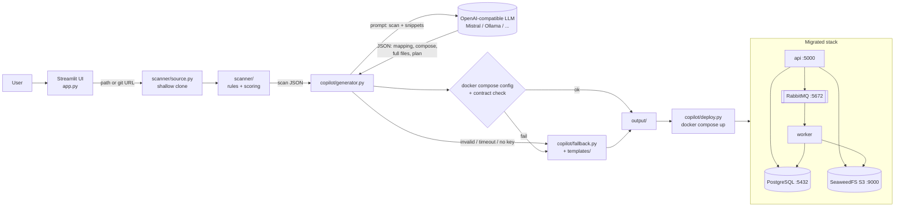

# 🚪 Egress — AWS lock-in scanner & exit copilot

Scan a repository, detect AWS hyperscaler lock-in, score it, let an LLM generate a
migration to open-source / EU-sovereign alternatives, and run the migrated stack
locally with `docker compose`, all from one Streamlit page.

## Problem

Teams build on AWS managed services (S3, RDS, SQS, Lambda, ...) because it's fast.
Years later, leaving is expensive: proprietary APIs are spread through the code,
data sits behind egress fees, and nobody knows *how* locked-in they really are.
EU data-sovereignty requirements make this an urgent question.

## Solution

1. **Scan**: rule-based detection over Terraform, docker-compose, Python and
   `requirements.txt`; Python is also parsed with `ast` (multi-line calls, import aliases,
   `boto3.Session().client(...)`, `service_name=`). Every finding has file, line, evidence, reason and severity.
2. **Score**: 0-100 per service and overall, weighted by proprietary API (50%),
   data format (30%) and egress cost (20%).
3. **Migrate**: an OpenAI-compatible LLM (Mistral, OpenAI, Ollama, vLLM...) produces
   a service mapping, a new `docker-compose.yml`, unified diffs and a migration
   plan with risks and effort. **Offline templates take over automatically** if the LLM
   is unavailable or wrong.
4. **Run**: one click runs `docker compose up` on the migrated stack
   (PostgreSQL + S3-compatible storage + RabbitMQ + container worker), then a smoke-test
   upload goes through the whole pipeline.

| AWS | Open-source replacement |
|---|---|
| S3 | SeaweedFS (S3 API); Garage / MinIO also work |
| RDS (Postgres) | PostgreSQL 16 |
| SQS / SNS | RabbitMQ (queue / fanout) |
| Lambda | Long-running container worker (OpenFaaS / Knative if FaaS needed) |
| DynamoDB | PostgreSQL JSONB / ScyllaDB |
| CloudWatch | json-file logs → Prometheus + Grafana + Loki |
| IAM | Static service credentials / Keycloak |

> **Why SeaweedFS and not MinIO?** MinIO no longer publishes community container images
> (Docker Hub / quay.io pulls fail), so the demo uses SeaweedFS (Apache 2.0, S3-compatible).
> The app only talks the S3 API via `endpoint_url`, so Garage (EU, Deuxfleurs) or MinIO can
> be swapped in by changing the `s3` service.

## Architecture



## Setup

Requirements: Linux, Python 3.11, Docker with Compose v2 (usable without sudo),
git, make. Free ports: 8501, 5000, 5432, 9000, 9001, 5672, 15672.

```bash
make install            # creates .venv (python3.11) and installs requirements
cp .env.example .env    # optional: add LLM_API_KEY for the LLM path
make run                # Streamlit on http://localhost:8501
```

### Option B: run Egress itself in Docker (host needs only Docker)

```bash
make docker-build       # pinned base images, ~2 min, ~1.3 GB
make docker-run         # UI on http://localhost:8501 (passes .env if present)
```

`docker-run` uses host networking, mounts the Docker socket (so Egress can deploy the stack;
this grants control of the host's Docker, local use only) and mounts `output/` **at the same
path** (`EGRESS_OUTPUT_DIR`) because compose bind mounts are resolved by the host daemon.
Files are written with your uid/gid.

Dependencies and container images are pinned (exact versions in `requirements.txt`,
`@sha256` digests in the Dockerfiles and the generated compose).

### Running on a fresh Linux VM (e.g. the hackathon VM)

Target: Ubuntu 24.04 with Docker (developed and tested in a GitHub Codespace on Ubuntu 24.04).
About 10 minutes, mostly image downloads; needs ~6 GB of free disk.

```bash
# 1. Docker + Compose v2 (skip if `docker compose version` already works)
sudo apt-get update && sudo apt-get install -y git make curl
curl -fsSL https://get.docker.com | sudo sh
sudo usermod -aG docker "$USER" && newgrp docker      # use Docker without sudo

# 2. Get Egress and (optionally) an LLM key
git clone https://github.com/Gabrululu/Egress.git && cd Egress
cp .env.example .env      # edit: LLM_API_KEY=...  (leave empty for offline templates)

# 3a. Run Egress in Docker (recommended: no Python setup on the VM)
make docker-build && make docker-run

# 3b. ...or natively. Ubuntu 24.04 ships Python 3.12 (Egress is developed on 3.11):
#     sudo apt-get install -y python3-venv && make install PYTHON=python3 && make run

# 4. Before the demo (second terminal, native install): pre-pull images and check readiness
make demo-warm && make demo-check
```

**Reaching the UI.** The migrated stack only listens on `127.0.0.1`, so only port **8501** matters:

- Presenter only (safest): `ssh -L 8501:localhost:8501 user@VM`, then open http://localhost:8501.
- Shared with the audience: open 8501 in the VM firewall / security group and add
  `EGRESS_PUBLIC=1` to `.env` (works for `make run`, `make run-public` and `make docker-run`).
  Visitors get the sandboxed demo; open `http://VM:8501/?key=<key>` yourself. With
  `make docker-run`, **set `EGRESS_ADMIN_KEY=<long random string>` in `.env`** (the container is
  ephemeral); natively the key is also auto-generated into `.cache/egress-admin-key`. See
  [Share the demo](#share-the-demo-from-a-codespace) for what visitors can and cannot do.

The VM is decommissioned after the event: nothing needs to persist, but don't leave real API keys
on it (`rm .env` when you're done).

### CI and GitHub Code Scanning

- `.github/workflows/ci.yml`: unit tests, offline migration + compose/policy validation, a real
  `docker compose up` of the migrated stack with an upload smoke test, and the Egress image build.
- `.github/workflows/egress-scan.yml`: Egress scans its own repo and uploads **SARIF** to
  *Security → Code scanning* (`sample_app/` alerts are expected: it is the locked-in demo).

```bash
python -m scanner . --sarif egress.sarif --exclude-dir tests --fail-above 70   # CI gate
```
Suppress a single line with a comment containing `egress: ignore` (like `# noqa`).

Other targets: `make test` (pytest), `make scan` (CLI scan of `sample_app`),
`make clean` (removes .venv, caches and generated output).
Different interpreter: `make install PYTHON=python3.12`.

### LLM configuration (`.env`)

| Var | Example | Notes |
|---|---|---|
| `LLM_BASE_URL` | `https://api.mistral.ai/v1` | Any OpenAI-compatible endpoint |
| `LLM_API_KEY` | `...` | Empty → offline templates (local URLs need no key) |
| `LLM_MODEL` | `mistral-medium-latest` | ~30 s per migration; `mistral-large-latest` is a reasoning model and took >10 min. e.g. `llama3.1` for Ollama |
| `LLM_TIMEOUT` | `60` | Seconds before falling back |

Ollama: `LLM_BASE_URL=http://localhost:11434/v1`, `LLM_API_KEY=ollama`, `LLM_MODEL=llama3.1`.

### CLI

```bash
.venv/bin/python -m scanner sample_app --summary        # human table
.venv/bin/python -m scanner sample_app --out scan.json  # JSON report
.venv/bin/python -m copilot sample_app [--no-llm]       # generate output/
cd output && docker compose up -d --build --wait        # run migrated stack
```

## 2-minute demo script

| Time | Do | Say |
|---|---|---|
| 0:00 | Open `localhost:8501`; show `sample_app/` (Flask + boto3 + `main.tf`) | "A typical upload service: S3, RDS, SQS, a Lambda, CloudWatch logs." |
| 0:15 | Click **🔍 Scan** | "32 findings across 7 services, each with file, line and the *reason* it locks you in. Overall score 63/100." |
| 0:35 | Point at service table + gauge, open *Scoring formula* | "Proprietary API weighs 50%, data format 30%, egress 20%. Lambda and S3 hurt most." |
| 0:50 | Click **🧠 Generate migration** | "The LLM gets the scan and code snippets and returns mapping, compose, migrated files and plan; Egress turns the files into exact diffs." |
| 1:05 | Show badge (LLM / Offline / Mixed), then tabs *Mapping → Code diffs → Plan* | "Every part is validated. If the LLM fails, built-in templates take over, so the demo never breaks. The diff is tiny: `endpoint_url`, pika instead of SQS, Lambda → worker." |
| 1:25 | Click **🚀 Deploy** | "`docker compose up`: Postgres, S3-compatible storage, RabbitMQ, API and worker, all open-source." |
| 1:45 | Click **🧪 Smoke test upload** | "Upload → object storage → Postgres → queue → worker marks it processed. Same app, zero AWS." |
| 1:50 | Click **⬇ Migration (.zip)** | "Everything is portable: compose, code, diffs, plan and a report. Secrets never leave." |
| 1:55 | Click **⏹ Stop** | "Egress: from lock-in to running locally in two minutes." |

**Before presenting:**

```bash
make demo-warm     # pre-pull pinned images + pre-build the app image (offline-safe Deploy)
make demo-check    # READY / NOT READY: Docker, compose, disk, images, ports, stack, UI, LLM, cache
make demo-reset CONFIRM=yes   # optional clean slate: stops the stack, wipes volumes + output/
```
Toggle **Force offline templates** in the sidebar if the network is unreliable.

## Fallback behavior

Everything that depends on the network or the LLM has an offline path:

| Situation | Behavior |
|---|---|
| No `LLM_API_KEY` (and non-local URL) | LLM skipped → all parts from templates (`path: fallback`) |
| Timeout / API / network error | Error recorded → templates (`fallback`) |
| Reply is not valid JSON | Templates (`fallback`) |
| A single part invalid (e.g. code that does not compile) | Only that part from templates (`path: mixed`) |
| LLM compose fails `docker compose config`, the contract or the security policy, or LLM code fails its checks | **One repair round** for every failing part: the errors are sent back to the LLM; each part it fixes is adopted, the rest come from templates (candidate compose kept as `docker-compose.llm.yml`) |
| Reply is not readable JSON | Retried once, then templates |
| LLM-written app passes every static check but **fails at runtime** (crash, no `/health`) | Deploy saves its api/worker logs, moves it to `output/app.llm-failed/` and **redeploys the reference app automatically**; the UI shows why |
| Same scan + model + prompt as a previous successful run | Answer served from the local cache `.cache/llm/` (instant, offline, free) |
| Docker not installed | Compose validated as YAML only; deploy shows an error |
| git clone fails / times out (90s) | Clear error in the UI, no stack trace |

The UI shows the path used (🤖 LLM / 📦 Offline templates / 🤖+📦 mixed), the
source of each part and the reason for each fallback. `output/result.json` records the same.

### Security policy for generated compose files

The Deploy button runs whatever the generator produced, and the LLM prompt contains code
from the scanned repo (prompt-injection risk). `copilot/policy.py` therefore rejects, both at
generation time and right before deploy:

- images outside an allowlist (postgres, seaweedfs, rabbitmq, garage, minio, redis, ...)
- `privileged`, `cap_add`, `devices`, `pid`/`ipc`/`network_mode: host`, `security_opt`, `sysctls`
- any reference to `docker.sock`, bind mounts or build contexts outside `output/`
- host ports outside the demo set (5000, 5432, 9000, 9001, 5672, 15672), or published on all
  interfaces: every port must bind `127.0.0.1` (Docker bypasses host firewalls such as ufw, so
  `"5432:5432"` on a VM would expose Postgres to the internet). LLM short-syntax ports are rebound automatically

Deploys run in the background (`output/.deploy.log`, live in the UI); busy host ports are
reported before starting.

### Data migration scripts

Generated in `output/data-migration/` for the detected services, with defaults inferred from
your Terraform (bucket, queue, DB name/user, region). All are **dry runs unless confirmed** and
run their tools in pinned containers (only Docker needed):

| Script | Moves | How | Verifies |
|---|---|---|---|
| `01_postgres.sh` | RDS → PostgreSQL | `pg_dump \| pg_restore --clean` | row counts per table |
| `02_s3.sh` | S3 → SeaweedFS | `rclone sync --checksum` | `rclone check --one-way` |
| `03_sqs_to_rabbitmq.py` | SQS → RabbitMQ | drain with publisher confirms, delete only after confirm | stats |
| `04_dynamodb.md` | DynamoDB | guide (data-model change) | - |

The UI also draws **before/after architecture diagrams** from the scan (Graphviz, no extra deps).

### Runnable app built from your repo

The LLM returns **complete migrated files**, never diffs (LLMs miscount hunk headers and mangle
patches). Egress computes exact git-style diffs itself with `difflib`, and before accepting the
code it builds the patched repo and checks that it compiles, reads the env vars the compose
provides (`S3_ENDPOINT_URL`, `AMQP_URL`, `QUEUE_NAME`, `DB_HOST`), contains no elided `...`
blocks or unsafe paths, and that a re-scan finds no AWS lock-in left. Files Egress manages
itself (`seaweedfs/s3.json`, `.env`, keys) are never taken from the LLM. LLM images are pinned
to the template digests, and the compose contract rejects `${VAR}`s that are never set,
bind-mounted data and missing healthchecks (`api` must expose `/health`).

After generating, Egress copies the scanned repo, applies every app-level diff with
`git apply --check` + `git apply` (git-style patches, so `lambda_function.py → worker.py` is a
real rename), retires AWS-only infrastructure (`*.tf`, the old compose) and verifies the result
(required `Dockerfile`/`app.py`/`worker.py`, every `.py` compiles, Dockerfile `FROM python`).
If everything passes, `output/app/` **is your patched code**; otherwise the reference template
is used and the UI lists which patch failed and why.

## Lock-in scoring formula

Each detected service has an intrinsic profile (0-100) on three dimensions
(see `scanner/rules.py::SERVICE_PROFILES`):

| Dimension | Weight | Meaning |
|---|---|---|
| `api` | 50% | How proprietary the API / programming model is |
| `data` | 30% | How proprietary the data format / semantics are |
| `egress` | 20% | Cost of moving data out (egress fees, volume) |

```
base          = 0.5*api + 0.3*data + 0.2*egress
depth         = min(1, Σ severity_weight)     # low=0.3, medium=0.6, high=1.0
service_score = round(base * depth)           # 0-100
overall       = round(0.5*max(service_scores) + 0.5*mean(service_scores))
rating        = high (>=70) | medium (>=40) | low
```

**Mitigations.** In a Python file that configures a non-AWS `endpoint_url`, boto3/S3 findings
are kept (flagged `mitigated`) but not scored: the client speaks the portable S3 API
(SeaweedFS, Garage, MinIO...). After generating, Egress re-scans the migrated stack and shows
**Before → After** (sample app: 63 → 0).

`depth` rewards evidence: a single low-severity hint scores far less than a
Terraform resource plus SDK calls. The overall score blends the worst service with the
average, so one deeply locked-in service is never hidden by many shallow ones.

Example: S3 with one high finding → `0.5*70 + 0.3*40 + 0.2*90 = 65`.

## Repository layout

```
scanner/      rules.py (regex rules + service profiles), engine.py (walk + score),
              source.py (path / git clone), __main__.py (CLI)
copilot/      config.py (env/.env), llm.py (client + prompt), generator.py (LLM → validate → fallback),
              fallback.py + templates/ (offline mapping, compose, migrated app), codegen.py (LLM files →
              exact diffs + checks), deploy.py + runner.py (background deploy, /health check, runtime fallback)
app.py        Streamlit UI (design tokens in ui_theme.py)
sample_app/   Demo app on AWS: Flask + boto3 (S3, RDS, SQS), Lambda handler, main.tf, compose
output/       Generated migration (gitignored except .gitkeep)
tests/        pytest: scanner rules/scoring, copilot paths, UI helpers + Streamlit AppTest
```

## Share the demo from a Codespace

```bash
make run-public   # UI in public demo mode (EGRESS_PUBLIC=1)
make public       # make port 8501 public and print the visitor + presenter URLs
make private      # close it again
```

Only port 8501 is published; the stack ports (API, RabbitMQ, SeaweedFS, Postgres) stay private.
GitHub shows visitors a one-time "development port" warning with a **Continue** button.

| | Visitor | Presenter (`?key=...`, removed from the address bar after login) |
|---|---|---|
| Scan | Bundled `sample_app` only (no host paths, no clones) | Any path or git URL |
| Generate | Offline templates or answers already in the LLM cache: never spends credits | Real LLM calls |
| Output | Private per-session folder (never touches `output/`) | `output/` |
| Deploy / Stop / Wipe | Hidden (container status + smoke test only) | Full control |

The presenter key comes from `EGRESS_ADMIN_KEY` or is generated into `.cache/egress-admin-key`
(gitignored, chmod 600). Run **Generate** once as presenter before sharing so visitors get the
LLM answer from the cache. Codespaces stop after the idle timeout (30 min by default): raise it
in GitHub → Settings → Codespaces before a long session.

## Security notes

- No secrets in the repo: only `.env.example`; `.env`, `output/` and `.cache/` are gitignored.
- **Generated credentials**: each migration writes `output/.env` (chmod 600) with random
  `DB_PASSWORD`, `RABBITMQ_PASSWORD`, `S3_SECRET_KEY`, reused on regeneration so existing data
  volumes keep working. *Stop → Wipe data & rotate credentials* deletes volumes and rotates them.
- **What reaches the LLM**: the UI's *What will be sent to the LLM* panel shows the exact prompt,
  lets you exclude files, estimates tokens, and masks likely secrets (AWS keys, passwords,
  tokens, private keys) before sending. Offline mode sends nothing; use Ollama for sensitive repos.
- Generated compose files pass a security policy before deploy (see above).
- In GitHub Codespaces, service links use the forwarded `*.app.github.dev` URLs automatically.

## License

Apache License 2.0, see [LICENSE](LICENSE).
